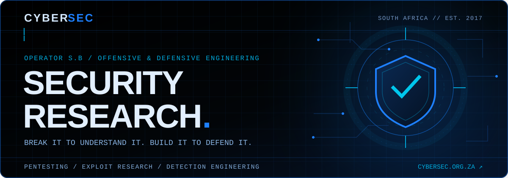

<!-- Cyber Sec profile: self-hosted artwork, GitHub-safe Markdown and SVG. -->
<div align="center">

<a href="https://cybersec.org.za" title="Cyber Sec — independent cybersecurity research"></a>

<br/>

[](https://cybersec.org.za/research.html)
[](https://cybersec.org.za)
[](https://github.com/s-b-repo?tab=repositories)
[](https://github.com/s-b-repo)

**Offensive research · Defensive engineering · Evidence over assumptions**

[Flagship work](#03--flagship-work) &nbsp;·&nbsp; [Toolkit](#06--open-source-tool-index) &nbsp;·&nbsp; [Work with Cyber Sec](https://cybersec.org.za/contact.html)

</div>

---

## `01 / OPERATOR PROFILE`

```yaml
operator:     S.B
discipline:   Security Research & Penetration Testing
practice:     Cyber Sec | South Africa
active_since: 2017
mission:      "Break it to understand it. Build it to defend it."
stack:        [Rust, Go, Python, C/C++, PowerShell, Bash]
areas:        [Adversary Simulation, Exploit Research, Code Audits, DFIR, Detection Engineering]
rules:        "Written authorization and agreed scope on every engagement."
```

I research how systems fail, build purpose-made tooling to test them under authorization, and turn the findings into practical defensive improvements. The work spans **vulnerability research, protocol and binary analysis, application security, offensive tooling, and SIEM/EDR engineering** — and the code here is the proof: reproducible experiments and real implementations, not a list of claims.

<div align="center">

| &nbsp;&nbsp;Shipping since&nbsp;&nbsp; | &nbsp;&nbsp;Public repositories&nbsp;&nbsp; | &nbsp;&nbsp;Primary languages&nbsp;&nbsp; | &nbsp;&nbsp;Discipline&nbsp;&nbsp; |
|:---:|:---:|:---:|:---:|
| **2017** | **310+** | **Rust · Python · Go** | **Offense → Defense** |

</div>

---

## `02 / CAPABILITIES`

| Offensive security | Research & assurance | Detection & defense |
| :--- | :--- | :--- |
| Penetration testing and adversary simulation | Vulnerability research and exploit development | Wazuh and Elastic-based monitoring |
| Network, wireless, IoT and embedded testing | Manual code and open-source audits | Detection engineering and DFIR workflows |
| Custom tooling in Rust, Go and Python | Reverse engineering and protocol analysis | Practical hardening and remediation |

<div align="center">

**Need a scoped, evidence-based security engagement?**

[](https://cybersec.org.za/contact.html)

<sub>All assessments require written authorization and agreed rules of engagement.</sub>

</div>

---

## `03 / FLAGSHIP WORK`

The projects that best show the range — from offensive research frameworks to a from-scratch inference engine and large-scale reverse engineering. Star counts are live.

| Project | Lang | Stars | What it demonstrates |
| :--- | :--- | :---: | :--- |
| **[rustsploit](https://github.com/s-b-repo/rustsploit)** | `Rust` | [](https://github.com/s-b-repo/rustsploit) | Modular IoT and embedded exploitation research framework — began as a RouterSploit rewrite, now its own platform. |
| **[nfsmw-2005-re](https://github.com/s-b-repo/nfsmw-2005-re)** | `Python` | [](https://github.com/s-b-repo/nfsmw-2005-re) | Large-scale reverse engineering: 6,500+ named functions across documented subsystems, with IDA tooling. |
| **[peregrine](https://github.com/s-b-repo/peregrine)** | `Rust` | [](https://github.com/s-b-repo/peregrine) | A Mixture-of-Experts LLM inference engine driving CPU, GPU, RAM and SSD concurrently via io_uring. |
| **[iNode-VPN](https://github.com/s-b-repo/iNode-VPN)** | `C++` | [](https://github.com/s-b-repo/iNode-VPN) | Full open-source iNode VPN client — Qt6/KF6 GUI plus a clean-room H3C SSL-VPN backend. 100% FOSS. |
| **[cau](https://github.com/s-b-repo/cau)** | `Go` | [](https://github.com/s-b-repo/cau) | An endpoint detection and response engine built for real coverage, not checkbox telemetry. |
| **[advanced-shodan-requests](https://github.com/s-b-repo/advanced-shodan-requests)** | `Docs` | [](https://github.com/s-b-repo/advanced-shodan-requests) | Curated Shodan query collection for exposure discovery and attack-surface mapping. |

---

## `04 / ENGINEERING STACK`

<div align="center">


</div>

---

## `05 / GITHUB SIGNAL`

<div align="center">


</div>

---

## `06 / OPEN-SOURCE TOOL INDEX`

Research tools, practical utilities and reference material. Everything here is published for authorized testing, defensive validation, and education. Expand a category to browse.

<details open>
<summary><b>Offensive Frameworks & Exploitation Research</b></summary>
<br/>

| Tool | Description | Link |
|:-----|:------------|:----:|
| **rustsploit** | IoT and embedded exploitation research framework in Rust | [](https://github.com/s-b-repo/rustsploit) |
| **firec2** | C2 research framework for authorized adversary emulation and detection validation | [](https://github.com/s-b-repo/firec2) |
| **gsoap-poc-exploits-2.7** | gSOAP proof-of-concept exploit research for IoT stacks | [](https://github.com/s-b-repo/gsoap-poc-exploits-2.7) |
| **rasberry-lie** | Wi-Fi deauthentication tool for wireless resilience testing | [](https://github.com/s-b-repo/rasberry-lie) |
| **i2cncit** | I2P-based C2 research over anonymous transports | [](https://github.com/s-b-repo/i2cncit) |

</details>

<details>
<summary><b>Reverse Engineering & Binary Analysis</b></summary>
<br/>

| Tool | Description | Link |
|:-----|:------------|:----:|
| **nfsmw-2005-re** | Reverse-engineering project — 6,500+ named functions across 30 subsystems | [](https://github.com/s-b-repo/nfsmw-2005-re) |
| **nfsmw-2005-sdk** | Cross-platform mod SDK — ASI Loader + BepInEx 6 | [](https://github.com/s-b-repo/nfsmw-2005-sdk) |
| **studious-garbanzo** | Forwards a Windows application's traffic through a proxy | [](https://github.com/s-b-repo/studious-garbanzo) |

</details>

<details>
<summary><b>AI, Inference & Security Automation</b></summary>
<br/>

| Tool | Description | Link |
|:-----|:------------|:----:|
| **peregrine** | Rust Mixture-of-Experts inference engine with io_uring | [](https://github.com/s-b-repo/peregrine) |
| **openhack** | AI-powered security-assessment agent for authorized pentesting | [](https://github.com/s-b-repo/openhack) |
| **opencode-mesh** | Coordination mesh for multiple CLI agent instances over MCP/HTTP | [](https://github.com/s-b-repo/opencode-mesh) |
| **yolo26-security-platform** | SOC dashboard with parallel camera workers and multi-frame confirmation | [](https://github.com/s-b-repo/yolo26-security-platform) |
| **onlyoffice-mcp-server** | MCP server for Office document automation — 77 async tools | [](https://github.com/s-b-repo/onlyoffice-mcp-server) |

</details>

<details>
<summary><b>DFIR, Monitoring & Defense</b></summary>
<br/>

| Tool | Description | Link |
|:-----|:------------|:----:|
| **cau** | Endpoint detection and response engine in Go | [](https://github.com/s-b-repo/cau) |
| **wazuh-setup-auto** | Automated Wazuh SIEM/EDR deployment for security monitoring | [](https://github.com/s-b-repo/wazuh-setup-auto) |
| **elastacat** | One-step Elastic Stack installer for rapid SIEM deployment | [](https://github.com/s-b-repo/elastacat) |
| **rubberup** | Rust security-audit checker for Arch Linux hardening | [](https://github.com/s-b-repo/rubberup) |
| **RBSL-** | Rust + Bash SIEM logger for security event pipelines | [](https://github.com/s-b-repo/RBSL-) |

</details>

<details>
<summary><b>Networking, Privacy & Systems</b></summary>
<br/>

| Tool | Description | Link |
|:-----|:------------|:----:|
| **iNode-VPN** | Full open-source VPN client — Qt6/KF6 GUI + clean-room SSL-VPN backend | [](https://github.com/s-b-repo/iNode-VPN) |
| **rustcord** | Rust screen recorder with camera support | [](https://github.com/s-b-repo/rustcord) |
| **linxboard** | Linux soundboard with a GUI for Arch and Debian | [](https://github.com/s-b-repo/linxboard) |

</details>

<details>
<summary><b>Reference, Guides & Knowledge Bases</b></summary>
<br/>

| Tool | Description | Link |
|:-----|:------------|:----:|
| **advanced-shodan-requests** | Curated Shodan queries for device and exposure discovery | [](https://github.com/s-b-repo/advanced-shodan-requests) |
| **cardsz** | RFID/NFC card security assessment guide (Proxmark3 methods) | [](https://github.com/s-b-repo/cardsz) |
| **xlibre-nvidea-guide** | Practical NVIDIA setup and troubleshooting reference | [](https://github.com/s-b-repo/xlibre-nvidea-guide) |

</details>

---

<div align="center">

### Let's work together

[](https://cybersec.org.za)
[](https://cybersec.org.za/research.html)
[](https://cybersec.org.za/contact.html)

</div>

<details>
<summary align="center"><sub>Support independent research</sub></summary>
<p align="center"><br/>
If this work has helped you, you can support more independent security research with Monero:<br/><br/>
<code>478Lb78LDscQ8ukEDTZqXgEtjoBX1jMuVGvgfy2RagxZZk89YuyVYsganfLUKnwggz8YiBxhG25yWWiHUppG9uarSiseseY</code><br/><br/>
<sub>XMR · Optional support, always appreciated.</sub>
</p>
</details>

<br/>

<div align="center">

<a href="https://cybersec.org.za"></a>

</div>
